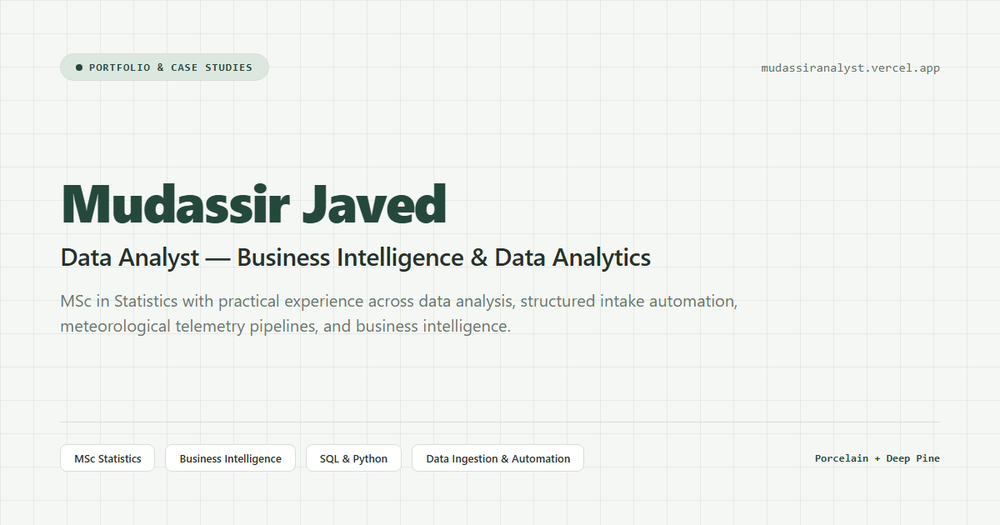
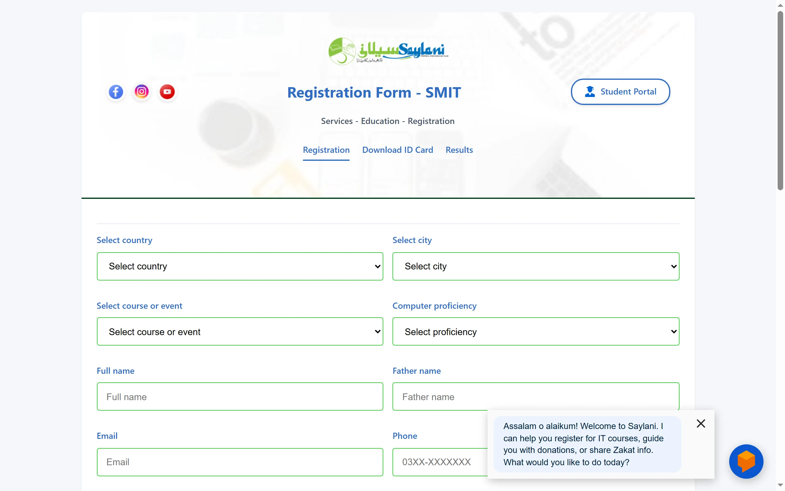
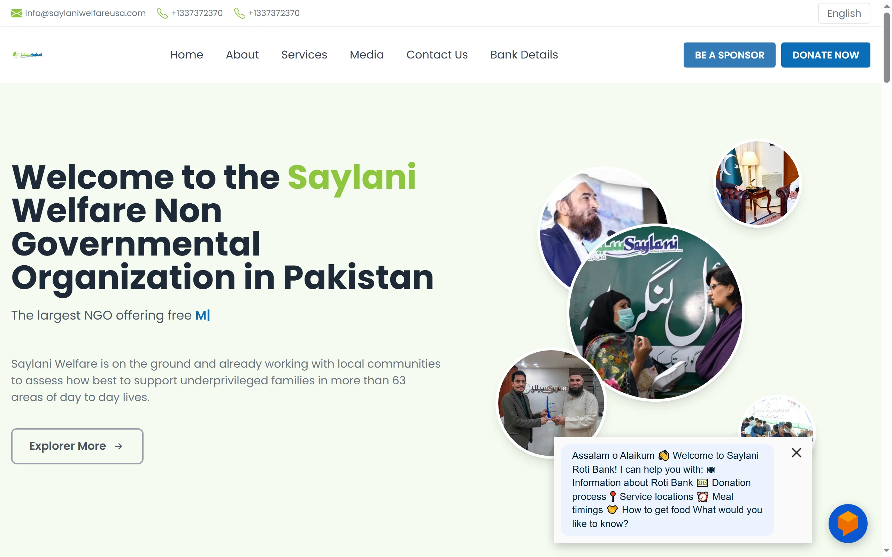
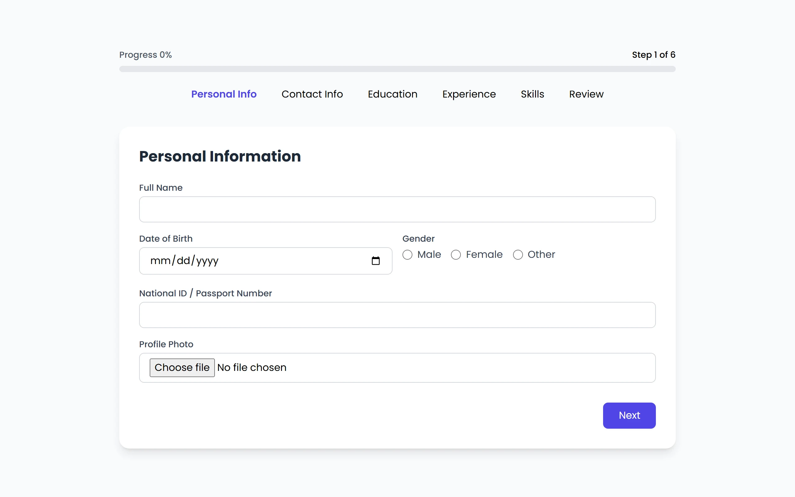
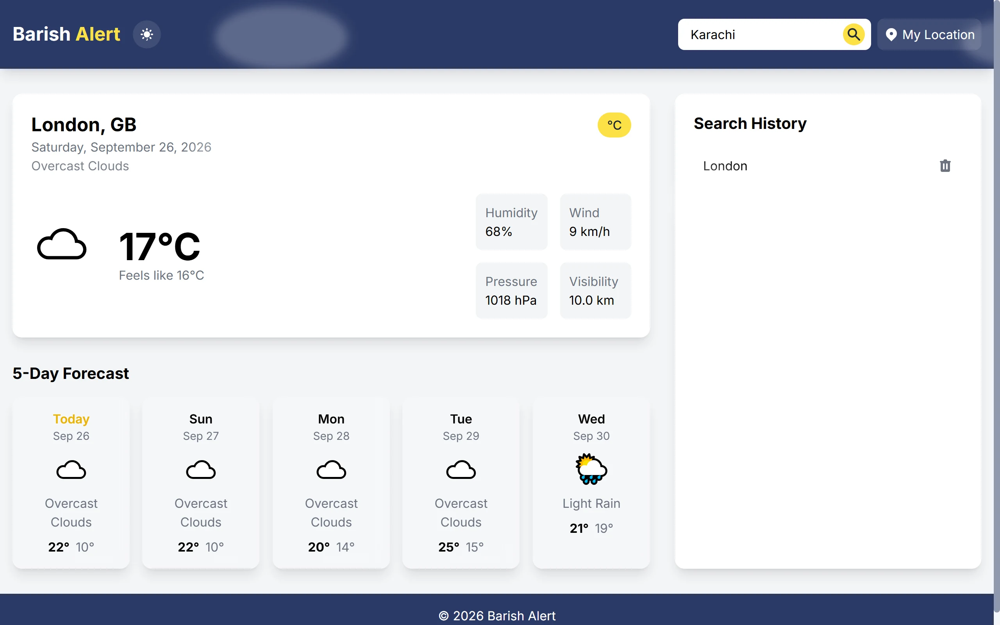

# Mudassir Javed

### **Data Analyst | Business Intelligence & Data Analytics**
*Turning Data Into Clear, Actionable Insight.*

Quetta, Pakistan

 

---

## 🧭 About Me

I am a **Data Analyst** with an **MSc in Statistics** from the **University of Balochistan (2023)**. My quantitative education shapes how I examine data: start with the business question, investigate empirical evidence, identify meaningful patterns, and communicate findings with precision.

My professional progression spans the full analytical journey:
1. **Statistics & Research** — Probability, hypothesis testing, quantitative modeling, and empirical rigor.
2. **Data Collection & Preparation** — Structured forms, data validation, Google Sheets integration, and cleaning.
3. **Business Intelligence & Reporting** — KPI tracking, executive dashboards, and metric presentation.
4. **Insights & Decision Support** — Translating complex analytical outputs into practical, actionable business recommendations.

> *"Statistics gives me the analytical foundation. Technology gives me the ability to build practical solutions around it."*

---

## 🌐 Live Portfolio Preview

The portfolio showcases interactive case studies, analytical capabilities, credentials, and professional philosophy.

  
  
<em>Explore interactive case studies, methodology, and credentials at <a href="https://mudassirdandor.vercel.app">mudassirdandor.vercel.app</a></em>

---

## 💼 Featured Projects

A selection of practical applications demonstrating data collection, workflow automation, API integration, and user-centric data presentation.

### 1. Saylani Student Registration System
**Data Collection · Automation · System Design**

An automated student registration chatbot that collects student information, stores records in Google Sheets, and generates student ID cards with downloadable PDF output.

  

- **Focus:** Structured student information collection and registration workflow
- **Key Capabilities:** Structured Data Collection, Google Sheets Integration, Workflow Automation, PDF Generation, Conversational Interface
- **Live Demo:** [saylanireg.netlify.app](https://saylanireg.netlify.app/)
- **Source Code:** [github.com/mudassirdandor/saylani-form](https://github.com/mudassirdandor/saylani-form)

---

### 2. Respondent Data Collection Chatbot
**Data Collection · Automation · Workflow**

An integrated chatbot workflow that collects respondent and donor information, stores structured records in Google Sheets, and dispatches automated email notifications to the project owner upon submission.

  

- **Focus:** Respondent data collection and Google Apps Script automation with owner email alerts
- **Key Capabilities:** Structured Data Collection, Dialogflow, Google Sheets, Google Apps Script, Email Automation
- **Live Demo:** [saylani-rotibank-mu.vercel.app](https://saylani-rotibank-mu.vercel.app/)
- **Source Code:** [github.com/mudassirdandor/Saylani_rotibank](https://github.com/mudassirdandor/Saylani_rotibank)

---

### 3. Job Application Data Collection System
**Structured Data · Form Design · Workflow**

A responsive multi-step application form with a progress indicator, designed to collect applicant information through a structured digital workflow with input validation.

  

- **Focus:** Structured job application data collection and guided multi-step workflow
- **Key Capabilities:** Structured Forms, Input Validation, Form Design, Workflow Processing, Responsive Web UI
- **Live Demo:** [jobapplica.netlify.app](https://jobapplica.netlify.app/)
- **Source Code:** [github.com/mudassirdandor/multi-step-form](https://github.com/mudassirdandor/multi-step-form)

---

### 4. Barish Alert — Weather Application
**API Data · Visualization**

A responsive weather application that retrieves and presents real-time meteorological metrics and 5-day forecasts through a clean, user-focused interface.

  

- **Focus:** Real-time weather data retrieval, meteorological telemetry presentation, and forecast visualization
- **Key Capabilities:** Weather API Integration, Data Presentation, Responsive Interface, Tailwind CSS
- **Live Demo:** [barishalert.netlify.app](https://barishalert.netlify.app/)
- **Source Code:** [github.com/mudassirdandor/weatherapp](https://github.com/mudassirdandor/weatherapp)

---

## 🛠️ Technical Toolkit

Organized by analytical domain with a focus on practical business application:

| Domain | Technologies & Tools |
| :--- | :--- |
| **Data Analysis & Programming** | `Python` `SQL` `R` `PostgreSQL` |
| **Business Intelligence & Visualization** | `Power BI` `Looker Studio` `Google Analytics 4 (GA4)` |
| **Productivity & Data Preparation** | `Microsoft Excel (Formulas, Pivot Tables, Modeling)` `Google Sheets` |
| **Platforms & Technical Workflows** | `Google BigQuery` `Git & GitHub` `REST APIs` `Google Apps Script` |

---

## 🎓 Education & Featured Credentials

### Academic Foundation
- **MSc in Statistics** — **University of Balochistan** *(Completed in 2023)*
  - Core Focus: Advanced statistical reasoning, probability distributions, quantitative research methods, hypothesis testing, and empirical data interpretation.

### Featured Professional Certifications
- **Google Data Analytics Professional Certificate** *(Google)*
  - End-to-end data analytics workflow: data cleaning, exploratory analysis, SQL querying, spreadsheet modeling, and R programming.
- **Google Advanced Data Analytics Professional Certificate** *(Google)*
  - Advanced statistical methods, regression modeling, exploratory data analysis (EDA), predictive concepts, and Python.
- **Google Business Intelligence Professional Certificate** *(Google)*
  - Enterprise BI architecture, data modeling, KPI tracking, and executive decision-support dashboard design.
- **40+ Professional Certifications & Skill Badges**
  - Cloud analytics (BigQuery, Looker, GA4), automation (Python IT Automation), and applied AI fundamentals.

---

## 📬 Connect & Collaborate

I am open to professional opportunities, data analytics roles, business intelligence projects, and collaborative initiatives.

- **Portfolio:** [mudassirdandor.vercel.app](https://mudassirdandor.vercel.app)
- **LinkedIn:** [linkedin.com/in/mudassirdandor](https://www.linkedin.com/in/mudassirdandor)
- **GitHub:** [github.com/mudassirdandor](https://github.com/mudassirdandor)
- **Email:** [mudassirdandor@gmail.com](mailto:mudassirdandor@gmail.com)
- **WhatsApp:** [+92 311 2777061](https://wa.me/923112777061)

 

  Designed & Developed by Mudassir Javed · Quetta, Pakistan

